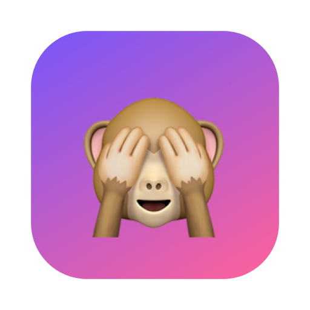
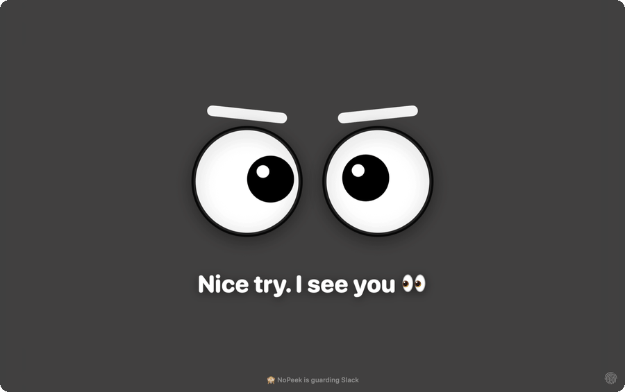
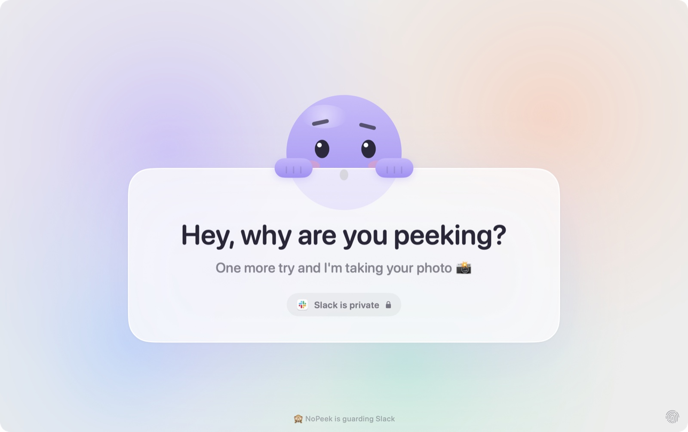
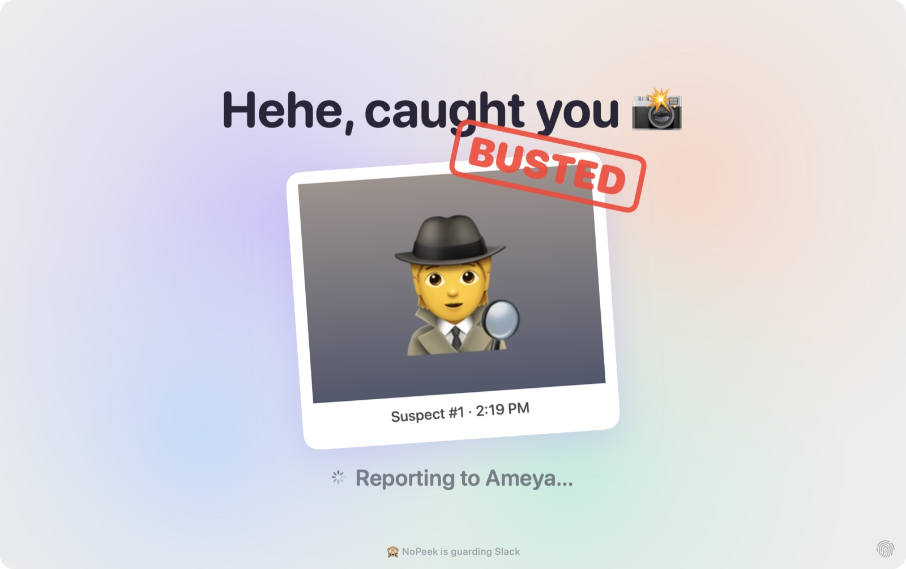
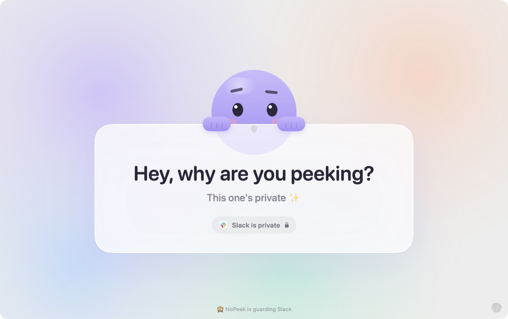
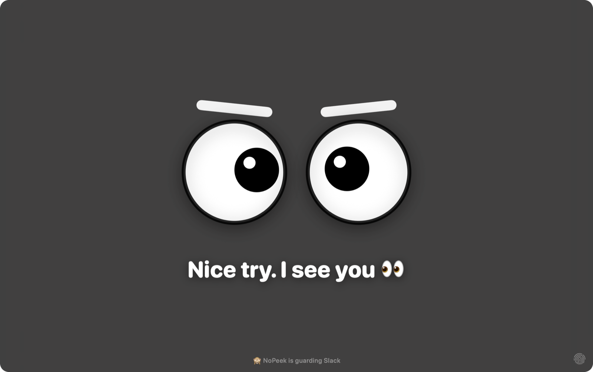
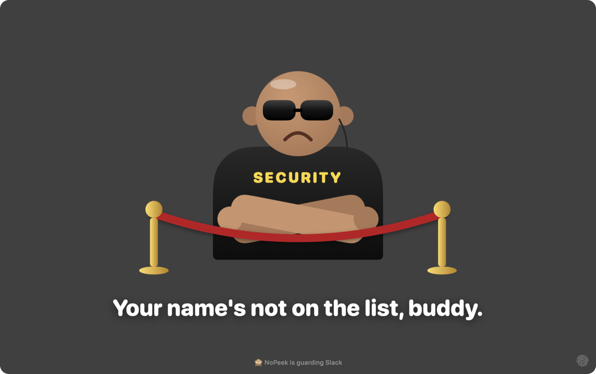
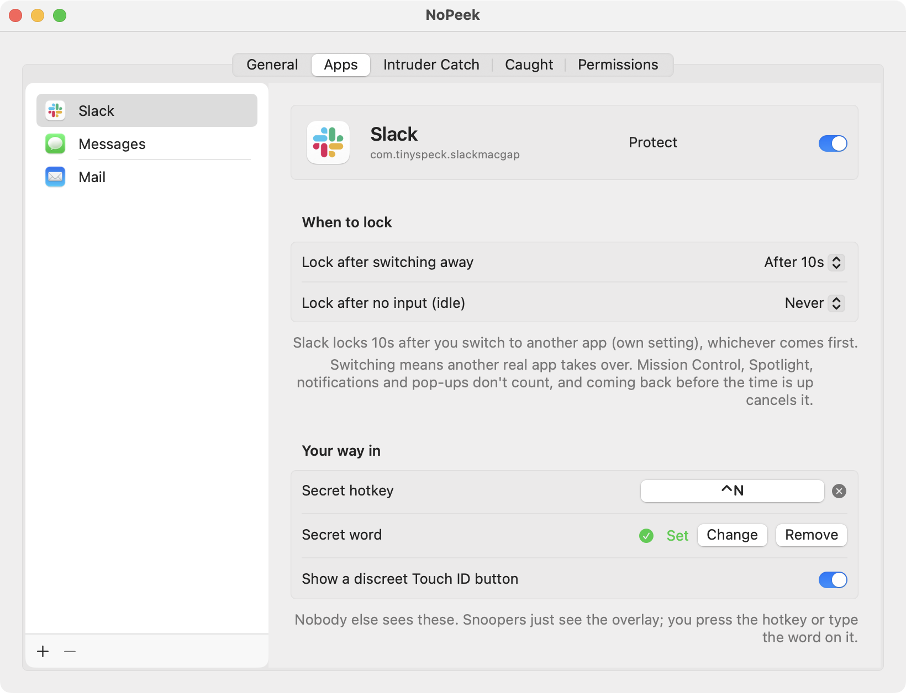
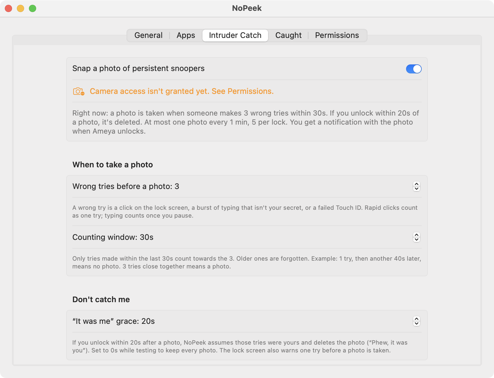
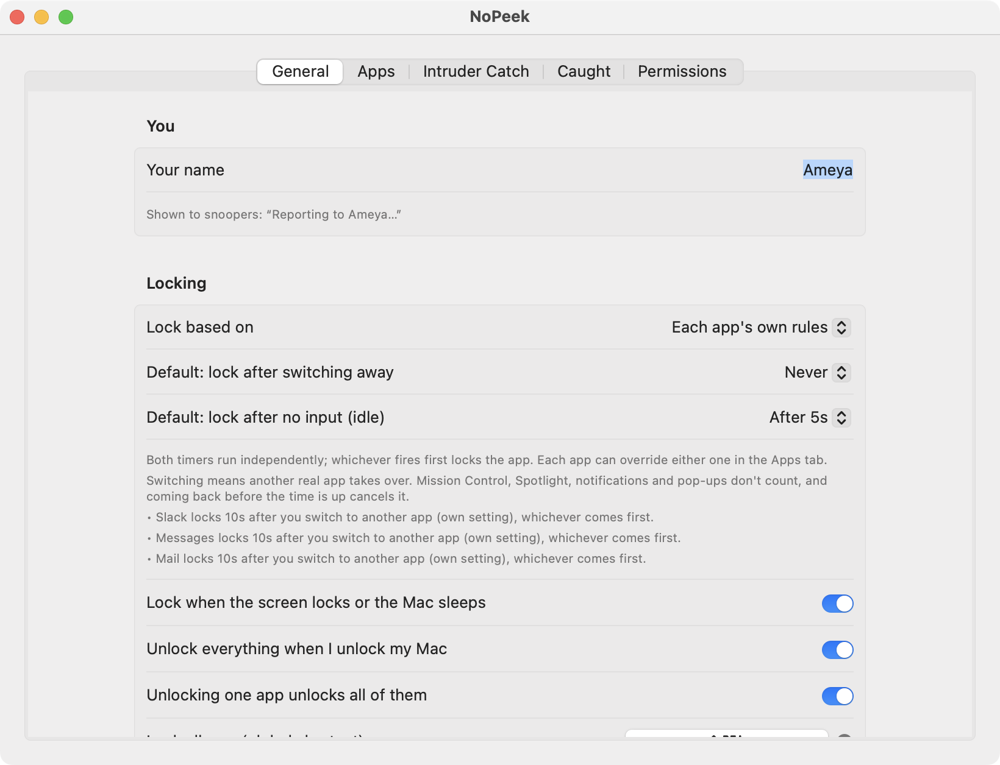

<div align="center">



# NoPeek

**Keep your laptop open and your terminal running. Keep everyone else out of Slack (or any app).**

A tiny macOS menu-bar app that locks individual apps behind a cheeky lock screen,
and snaps a photo of anyone who keeps poking at it.


<br />



</div>

---

## Why

You step away for coffee. Your laptop stays open because a build is running, a long script is churning,
or you just don't want to log out. But Slack is right there, DMs and all.

NoPeek locks **just the apps you choose**. Everything else keeps running. Your terminal never stops.

## How it works

1. **It hides the app.** When a protected app locks, NoPeek hides it (like ⌘H), so its content is gone from every Space and display.
2. **It guards the door.** If anyone brings it back (⌘Tab, Dock, notification, swipe), a frosted lock screen covers every display with a slightly rude illustration.
3. **Only you get back in.** A secret hotkey, a secret word typed on the lock screen, or a discreet Touch ID tap. Snoopers see no hint of any of them.
4. **It catches persistent snoopers.** Keep poking and it warns, then snaps a photo: *"Hehe, caught you 📸 Reporting to Ameya…"*

<table>
  <tr>
    <td width="50%"></td>
    <td width="50%"></td>
  </tr>
  <tr>
    <td align="center"><sub>One wrong try too many: a fair warning first</sub></td>
    <td align="center"><sub>…then the snooper gets their mugshot</sub></td>
  </tr>
</table>

### The full flow

```
 You walk away            Someone opens Slack          They poke at it            You come back
 ─────────────            ───────────────────          ───────────────            ─────────────
 Slack locks (switch-  →  Slack is hidden; bringing →  Each click / typed    →   Hotkey, secret word or
 away, idle, whole-Mac     it back shows the lock       burst / failed Touch ID    Touch ID → "Welcome back"
 idle, screen lock, or     screen on every display      is a wrong try. Roasts     All apps unlock together
 ⌃⌥L "Lock all")                                        escalate, a warning,       🚨 "Caught a snooper on
                                                        then 📸 BUSTED              Slack" notification
```

If the photo was actually you (you unlock within the grace period), it's deleted and you get *"Phew, it was you."*

## Themes

Pick one, or let 🎲 **Shuffle** choose a different one each lock. Every theme escalates with each try.

<table>
  <tr>
    <td width="33%"></td>
    <td width="33%"></td>
    <td width="33%"></td>
  </tr>
  <tr>
    <td align="center"><b>🫣 Peekaboo</b><br /><sub>Light, frosted pastel</sub></td>
    <td align="center"><b>👀 Googly Eyes</b><br /><sub>Eyes follow the mouse</sub></td>
    <td align="center"><b>🕶️ The Bouncer</b><br /><sub>Your name's not on the list</sub></td>
  </tr>
</table>

## Features

- 🔒 **Any app.** Add from running apps or /Applications. Each app gets its own unlock methods and lock timing.
- 🤫 **Invisible ways in.** A recordable secret hotkey, a secret word (stored as a salted hash), and/or a discreet Touch ID button.
- 📸 **Intruder catch that never catches *you*.**
  - Photo only after N wrong tries within M seconds (default 3 in 30s), with a "one more and I'm taking your photo" warning first.
  - "It was me" grace: unlock within 20s of a photo and it's deleted.
  - Cooldown between photos, max photos per lock, auto-purge after N days.
  - The camera is used only if you already allowed it. Snoopers never see a permission prompt.
- 📬 **Report to owner.** A notification with the photo when you're back, plus a Caught gallery.
- 🛡️ **Tamper resistance.** Unlock, Pause, Settings and Quit (including ⌘Q) need Touch ID or your password while anything is locked. Settings closes itself when locking kicks in.
- ⏱️ **Smart locking.** Per-app rules (switch-away and/or idle), or **whole-Mac inactivity** mode: one Mac-wide idle timer locks everything together and overrides per-app rules, so switching apps never locks. Plus screen lock/sleep and a global "Lock all" hotkey (default ⌃⌥L). Unlocking your Mac unlocks everything (optional).
- 🪶 **Featherweight.** 0% CPU while a locked app sits in the background.

## Settings

<table>
  <tr>
    <td width="50%"></td>
    <td width="50%"></td>
  </tr>
  <tr>
    <td align="center"><sub><b>Apps</b>: when each app locks, and your secret ways back in</sub></td>
    <td align="center"><sub><b>Intruder Catch</b>: when to snap, and how not to catch yourself</sub></td>
  </tr>
</table>

<details>
<summary><b>General settings</b></summary>
<br />

</details>

## Getting started

**Requirements:** macOS 14 (Sonoma) or later, Apple Silicon, Xcode command-line tools (Swift 5.9+).

```bash
git clone https://github.com/AmeyaJain-25/nopeek.git
cd nopeek
make run       # build → ~/Applications/NoPeek.app → launch
```

NoPeek lives in your menu bar (🙈). On first launch it opens Settings on the Permissions tab.

### First-run setup

1. **Permissions:** grant Camera, Accessibility and Notifications (see [below](#permissions)).
2. **General → Your name:** this is who snoopers are "reported" to. It defaults to *Ameya*, so change it.
3. **Apps:** Slack is protected by default. Add more with **+** (or *Protect "…"* from the menu bar), then choose when each one locks.
4. **Your way in:** record a secret hotkey, set a secret word, and/or keep the Touch ID button.
5. **Try it:** `--preview` (below) shows the real lock screen in a window, so you can test your secrets safely.

### From the menu bar

| Item | What it does |
|---|---|
| 🔓 *App* — Lock Now / 🔒 *App* — Unlock… | Lock one app now, or unlock it (Touch ID / password) |
| ➕ Protect "*front app*" | Add whatever app you're in to the protected list |
| 🔒 Lock All Now | Lock every protected app (also ⌃⌥L from anywhere) |
| ⏸ Pause Protection | For 15 minutes, 1 hour, or until you resume |
| 📸 Caught Snoopers… | Open the gallery (shows a count of new catches) |
| Settings… / Quit | Both need Touch ID or your password while anything is locked |

> **Recommended once:** `scripts/create-signing-identity.sh`
> This creates a stable local signing identity so macOS remembers Camera/Accessibility permissions across rebuilds.
> Without it, ad-hoc signing means re-granting them after every `make install`.

| Command | What it does |
|---|---|
| `make test` | Unit tests (NoPeekCore + lock session logic) |
| `make build` | Build `build/NoPeek.app` |
| `make install` | Build and copy to `~/Applications` |
| `make run` | Install and launch |

Dev flags: `open ~/Applications/NoPeek.app --args --lock-all` (lock immediately) or `--preview` (show the lock screen in a window).

## Permissions

| Permission | Why | Without it |
|---|---|---|
| 📷 Camera | Snooper photos | Overlay says "Camera shy? Logged anyway." |
| ⌨️ Accessibility | Swallows keystrokes aimed at a locked app | Overlay still grabs focus; tiny race on ⌘Tab |
| 🔔 Notifications | "Caught 2 snoopers on Slack" | Check the Caught tab |

## Design: why hide + shield

Earlier versions glued an overlay onto the app's window. That fights macOS: windows belong to Spaces,
so swipes, full-screen apps and multiple displays needed constant window polling. Now:

- **Locked app in background**: hidden; nothing tracked or polled → **0% CPU**.
- **Locked app brought forward**: one shield panel per display (`canJoinAllSpaces`, above the menu bar),
  created on demand and destroyed when you leave, so nothing renders while it isn't on screen.
- **Event-driven animations**: eyes move only when the mouse moves; blinks and peeks are short one-off animations;
  the pastel background runs on Core Animation in the render server.
- **Keystroke guard** (Accessibility) is enabled only while something is locked: zero typing overhead otherwise.
- **Always recoverable**: apps NoPeek hid are unhidden on quit, `pkill`, and even after a crash (recovered on next launch).

## Project layout

```
Sources/NoPeekCore/   pure logic: models, IntruderPolicy, OwnerGrace, SecretHasher, copy (unit tested)
Sources/NoPeek/
  App/       entry point, AppCoordinator (wiring + guarded owner actions)
  Core/      LockEngine, LockSession, stores, camera, Touch ID, hotkeys, keystroke guard
  Overlay/   shield panels, overlay views, themes
  Settings/  settings window, shortcut recorder
  MenuBar/   menu-bar menu
Tests/       NoPeekCoreTests, NoPeekTests
scripts/     build, icon rendering, local signing identity
```

Data lives in `~/Library/Application Support/NoPeek/` (`settings.json`, `secrets.json`, `Captures/`).

## Honest limits

It's a deterrent, not a vault.

- Someone who knows macOS could force-quit it from Activity Monitor.
- When you really walk away, ⌃⌘Q (lock screen) still wins. Your terminal keeps running either way.
- Notification banners from Slack can still show previews. Turn those off in Slack if that matters.

<div align="center">
<br />
<sub>Made with 🙈 for people who leave their laptop open.</sub>
</div>
